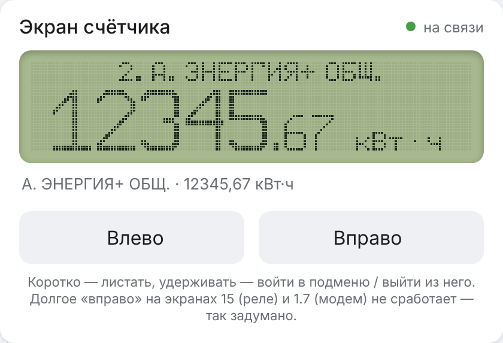

# Счётчики М2М-1С / М2М-3Т в Home Assistant через ESPHome (экран по Bluetooth)

Компонент ESPHome, который читает показания однофазных **М2М-1С** и трёхфазных **М2М-3Т** (Калужский завод
электронных изделий, КПЗ) **с экрана счётчика по Bluetooth** — так же, как официальное приложение «Дисплей М2М».
ESP32 получает картинку экрана, распознаёт цифры и буквы, листает экраны «кнопками» и отдаёт значения в Home Assistant.
Пароль счётчика, оптопорт и провода не нужны.

> ⚠️ **Проверено только на одном счётчике — М2М-1С** (через ESP32-S3 и ESP32-C3), у которого энергосбыт оставил
> экраны 2–12 и подменю 1.5–1.7. Всё остальное из Приложения Г руководства (М2М-3Т, тарифы Т3–Т4, экраны 13–16,
> 1.2–1.4, сведения GSM) сделано **по документации** и в реальности не проверялось.
> Если у вас другой счётчик или другие экраны — включите `report_unknown`, пришлите лог в
> [issue](../../issues/new/choose), и вместе доделаем. Помощь в разработке приветствуется!

## Как это работает

Bluetooth-модуль счётчика отдаёт копию экрана (160×32 точки) и принимает нажатия кнопок. Протокол взят из
приложения `ru.kpsz.meterdisplay`:

| Характеристика | Назначение |
|---|---|
| сервис `FFF0`, чтение `FFF2` | кадр экрана: маркер `0x00`, затем 640 байт (4 страницы по 160 столбцов, бит 0 — верхняя точка) |
| запись `FFF3` | «кнопка»: `1` влево, `2` вправо, `3` долго влево, `4` долго вправо, `0xFF` — «я на связи» |

Экран распознаётся по **заголовку буквами** (а не по номеру): энергосбыт может скрыть часть экранов, и номера
у разных счётчиков идут с пропусками. Раз в `update_interval` компонент обходит только те экраны и подменю,
которые нужны включённым сенсорам, и возвращается. Первый обход начинается примерно через минуту после
подключения к счётчику (не ждёт `update_interval`) и идёт дольше — счётчик «изучается»: какие экраны есть и где какие.

Между обходами на счётчике стоит начальный экран, и компонент продолжает его читать. Поэтому `current_tariff`
меняется в течение 20–30 секунд после смены тарифа (смена засчитывается после трёх одинаковых чтений подряд),
а не при следующем обходе.

## Возможности

- все экраны Приложения Г: энергия А±/Р± итог и за месяц, **по тарифам Т1–Т4**, максимум мощности за месяц и
  за сутки, коэффициент мощности, ток, мощности P/Q/S, **дифференциальный ток (утечка)**, напряжение, частота,
  текущий тариф, время работы, журнал событий, тарифное расписание, состояние реле, сообщения, паспорт, версия ПО,
  самодиагностика, уровень сигнала GSM;
- для М2М-3Т — значения по фазам A/B/C (`*_a`, `*_b`, `*_c`);
- каждый сенсор включается в YAML отдельно, лишние экраны не листаются;
- `every: N` — читать сенсор не каждый обход, а раз в N обходов;
- **автоматический поиск счётчика**: `mac_address: 00:00:00:00:00:00` — ESP найдёт счётчик сама; если рядом
  несколько — выведет список в лог и в сенсор `found_meters`;
- «живые» значения (ток, мощность) берутся со второго кадра, остальные — когда два кадра подряд совпали;
- защита от ошибки распознавания основного показания (не убывает, не прыгает больше чем на 50 кВт·ч);
- сторож: если картинка экрана застыла (у модуля счётчика такое бывает) — переподключение Bluetooth;
- `report_unknown`: описание каждого нового экрана и картинки незнакомых знаков — в лог, чтобы прислать в issue.

## Безопасность

Долгое «вправо» на некоторых экранах **меняет настройки счётчика**: на экране 15 переключает реле нагрузки,
в подменю 1.7 — выбирает оператора и перезагружает модем. Поэтому компонент нажимает долгое «вправо» **только**
на экранах из «белого списка» (энергия 2–9, максимум мощности 10, параметры нагрузки 11, начальный экран, 1.6),
и только когда заголовок экрана распознан полностью. Кнопка «Экран долго вправо» из примера подчиняется тем же
правилам. Экраны 13–16 только читаются.

## Установка

1. ESP32 с Bluetooth (проверено на ESP32-S3 и ESP32-C3), в радиусе Bluetooth от счётчика. Лучше с постоянным питанием.
2. Возьмите [`example/m2m-meter.yaml`](example/m2m-meter.yaml), впишите Wi-Fi и включите нужные сенсоры.
3. Компонент подключается так:
   ```yaml
   external_components:
     - source: github://Lordhmen/M2M-Meter-Display_ESPHome@main
       components: [m2m_display]
   ```
4. Прошейте и посмотрите лог: `Найден счётчик: «M2M_1» …`, `Подключено к счётчику`, затем
   `Обход экранов завершён: всё прочитано за … с`.

### Параметры `m2m_display`

| Параметр | По умолчанию | Что делает |
|---|---|---|
| `ble_client_id` | — | id блока `ble_client` |
| `update_interval` | `1h` | как часто обходить экраны |
| `screen_timeout` | `9s` | сколько ждать смены экрана после нажатия (кадры приходят раз в ~3,5 с) |
| `read_interval` | `150ms` | пауза между чтениями кусков кадра |
| `keepalive_interval` | `8s` | как часто слать «я на связи» |
| `report_unknown` | `true` | описания новых экранов и незнакомые знаки — в лог |
| `log_frames` | `false` | печатать каждый кадр (HEX и картинкой из `#`) — для разработки |
| `log_min_interval` | `5s` | не чаще одного кадра в лог за этот интервал |
| `discovery_name` | `M2M` | начало имени устройства при автоматическом поиске |
| `found_meters` | — | текстовый сенсор: какие счётчики видны рядом |

У каждого сенсора, кроме обычных параметров ESPHome, есть `every` (по умолчанию `1`).

### Кнопки из лямбд

`id(meter_display).press(n)` — `1` влево, `2` вправо, `3` долго влево, `4` долго вправо (только на безопасных экранах).
`id(meter_display).frames_count()`, `stale_count()` — сколько кадров получено и сколько раз картинка застывала.

## Карточка «Экран счётчика» для Home Assistant

В `dist/m2m-display-card.js` — карточка Lovelace, которая повторяет приложение «Дисплей М2М»: показывает экран
счётчика точка в точку и даёт листать его кнопками (коротко — листать, удерживать — войти в подменю или выйти).

<p align="center"></p>
<p align="center"><sub>Показания на скриншоте вымышленные.</sub></p>

1. Включите в YAML блок `live_view` (появятся выключатель «Живой экран», 4 сенсора кадра, текст экрана и 4 кнопки):
   ```yaml
   m2m_display:
     live_view:
       timeout: 3min      # сам выключится, если никто не жмёт кнопки
   ```
2. Установите карточку через HACS (**HACS → ⋮ → Пользовательские репозитории**, адрес этого репозитория, тип
   «Dashboard»), либо вручную: скопируйте `dist/m2m-display-card.js` в `/config/www/` и добавьте ресурс `/local/m2m-display-card.js?v=1.0.0`
   (тип «JavaScript module») в **Настройки → Панели → Ресурсы**.
3. Добавьте карточку:
   ```yaml
   type: custom:m2m-display-card
   entity: switch.<устройство>_zhivoi_ekran_m2m_live   # остальные сущности карточка найдёт сама
   title: Счётчик
   ```

Пока карточка открыта, она держит «Живой экран» включённым, а автоматический обход экранов в это время ждёт;
если обход был прерван или отложен из-за живого экрана, он повторяется через минуту после его выключения.
Картинка меняется через 1–4 с после нажатия — так работает Bluetooth-модуль счётчика (в приложении так же).
Кадр отправляется только при включённом «Живом экране». Сенсоры кадра при этом обновляются несколько раз в секунду,
а в истории они не нужны — исключите их из `recorder` в `configuration.yaml`:

```yaml
recorder:
  exclude:
    entity_globs:
      - sensor.*_m2m_frame_*
      - sensor.*_m2m_screen
```


## Сенсоры

✅ — проверено на реальном М2М-1С; — — сделано по Приложению Г, нужна проверка.
Названия в YAML пишите с латинскими буквами в скобках (`Ток (current)`): ESPHome строит id сущности из латиницы,
и чисто русские имена могут совпасть.

| Ключ YAML | Экран (заголовок) | Где | Как читается | Проверено |
|---|---|---|---|---|
| `energy_import_total` | «А.ЭНЕРГИЯ+ОБЩ.» | верхний уровень | значение | ✅ |
| `energy_import_t1` | «А.ЭНЕРГИЯ+ОБЩ.Т1» | подменю «А.ЭНЕРГИЯ+ОБЩ.» | значение | ✅ |
| `energy_import_t2` | «А.ЭНЕРГИЯ+ОБЩ.Т2» | подменю «А.ЭНЕРГИЯ+ОБЩ.» | значение | ✅ |
| `energy_import_t3` | «А.ЭНЕРГИЯ+ОБЩ.Т3» | подменю «А.ЭНЕРГИЯ+ОБЩ.» | значение | — |
| `energy_import_t4` | «А.ЭНЕРГИЯ+ОБЩ.Т4» | подменю «А.ЭНЕРГИЯ+ОБЩ.» | значение | — |
| `energy_export_total` | «А.ЭНЕРГИЯ-ОБЩ.» | верхний уровень | значение | ✅ |
| `energy_export_t1` | «А.ЭНЕРГИЯ-ОБЩ.Т1» | подменю «А.ЭНЕРГИЯ-ОБЩ.» | значение | — |
| `energy_export_t2` | «А.ЭНЕРГИЯ-ОБЩ.Т2» | подменю «А.ЭНЕРГИЯ-ОБЩ.» | значение | — |
| `energy_export_t3` | «А.ЭНЕРГИЯ-ОБЩ.Т3» | подменю «А.ЭНЕРГИЯ-ОБЩ.» | значение | — |
| `energy_export_t4` | «А.ЭНЕРГИЯ-ОБЩ.Т4» | подменю «А.ЭНЕРГИЯ-ОБЩ.» | значение | — |
| `reactive_import_total` | «Р.ЭНЕРГИЯ+ОБЩ.» | верхний уровень | значение | ✅ |
| `reactive_import_t1` | «Р.ЭНЕРГИЯ+ОБЩ.Т1» | подменю «Р.ЭНЕРГИЯ+ОБЩ.» | значение | — |
| `reactive_import_t2` | «Р.ЭНЕРГИЯ+ОБЩ.Т2» | подменю «Р.ЭНЕРГИЯ+ОБЩ.» | значение | — |
| `reactive_import_t3` | «Р.ЭНЕРГИЯ+ОБЩ.Т3» | подменю «Р.ЭНЕРГИЯ+ОБЩ.» | значение | — |
| `reactive_import_t4` | «Р.ЭНЕРГИЯ+ОБЩ.Т4» | подменю «Р.ЭНЕРГИЯ+ОБЩ.» | значение | — |
| `reactive_export_total` | «Р.ЭНЕРГИЯ-ОБЩ.» | верхний уровень | значение | ✅ |
| `reactive_export_t1` | «Р.ЭНЕРГИЯ-ОБЩ.Т1» | подменю «Р.ЭНЕРГИЯ-ОБЩ.» | значение | — |
| `reactive_export_t2` | «Р.ЭНЕРГИЯ-ОБЩ.Т2» | подменю «Р.ЭНЕРГИЯ-ОБЩ.» | значение | — |
| `reactive_export_t3` | «Р.ЭНЕРГИЯ-ОБЩ.Т3» | подменю «Р.ЭНЕРГИЯ-ОБЩ.» | значение | — |
| `reactive_export_t4` | «Р.ЭНЕРГИЯ-ОБЩ.Т4» | подменю «Р.ЭНЕРГИЯ-ОБЩ.» | значение | — |
| `energy_import_month` | «А.ЭНЕРГИЯ+МЕС.» | верхний уровень | значение | ✅ |
| `energy_import_month_t1` | «А.ЭНЕРГИЯ+МЕС.Т1» | подменю «А.ЭНЕРГИЯ+МЕС.» | значение | — |
| `energy_import_month_t2` | «А.ЭНЕРГИЯ+МЕС.Т2» | подменю «А.ЭНЕРГИЯ+МЕС.» | значение | — |
| `energy_import_month_t3` | «А.ЭНЕРГИЯ+МЕС.Т3» | подменю «А.ЭНЕРГИЯ+МЕС.» | значение | — |
| `energy_import_month_t4` | «А.ЭНЕРГИЯ+МЕС.Т4» | подменю «А.ЭНЕРГИЯ+МЕС.» | значение | — |
| `energy_export_month` | «А.ЭНЕРГИЯ-МЕС.» | верхний уровень | значение | ✅ |
| `energy_export_month_t1` | «А.ЭНЕРГИЯ-МЕС.Т1» | подменю «А.ЭНЕРГИЯ-МЕС.» | значение | ✅ |
| `energy_export_month_t2` | «А.ЭНЕРГИЯ-МЕС.Т2» | подменю «А.ЭНЕРГИЯ-МЕС.» | значение | ✅ |
| `energy_export_month_t3` | «А.ЭНЕРГИЯ-МЕС.Т3» | подменю «А.ЭНЕРГИЯ-МЕС.» | значение | — |
| `energy_export_month_t4` | «А.ЭНЕРГИЯ-МЕС.Т4» | подменю «А.ЭНЕРГИЯ-МЕС.» | значение | — |
| `reactive_import_month` | «Р.ЭНЕРГИЯ+МЕС.» | верхний уровень | значение | ✅ |
| `reactive_import_month_t1` | «Р.ЭНЕРГИЯ+МЕС.Т1» | подменю «Р.ЭНЕРГИЯ+МЕС.» | значение | — |
| `reactive_import_month_t2` | «Р.ЭНЕРГИЯ+МЕС.Т2» | подменю «Р.ЭНЕРГИЯ+МЕС.» | значение | — |
| `reactive_import_month_t3` | «Р.ЭНЕРГИЯ+МЕС.Т3» | подменю «Р.ЭНЕРГИЯ+МЕС.» | значение | — |
| `reactive_import_month_t4` | «Р.ЭНЕРГИЯ+МЕС.Т4» | подменю «Р.ЭНЕРГИЯ+МЕС.» | значение | — |
| `reactive_export_month` | «Р.ЭНЕРГИЯ-МЕС.» | верхний уровень | значение | ✅ |
| `reactive_export_month_t1` | «Р.ЭНЕРГИЯ-МЕС.Т1» | подменю «Р.ЭНЕРГИЯ-МЕС.» | значение | — |
| `reactive_export_month_t2` | «Р.ЭНЕРГИЯ-МЕС.Т2» | подменю «Р.ЭНЕРГИЯ-МЕС.» | значение | — |
| `reactive_export_month_t3` | «Р.ЭНЕРГИЯ-МЕС.Т3» | подменю «Р.ЭНЕРГИЯ-МЕС.» | значение | — |
| `reactive_export_month_t4` | «Р.ЭНЕРГИЯ-МЕС.Т4» | подменю «Р.ЭНЕРГИЯ-МЕС.» | значение | — |
| `max_power_month` | «МАКС.МОЩНОСТИМЕС.» | верхний уровень | значение | ✅ |
| `max_power_month_a` | «МАКС.МОЩНОСТИМЕС.» | верхний уровень | строка фазы «A» | — |
| `max_power_month_b` | «МАКС.МОЩНОСТИМЕС.» | верхний уровень | строка фазы «B» | — |
| `max_power_month_c` | «МАКС.МОЩНОСТИМЕС.» | верхний уровень | строка фазы «C» | — |
| `max_power_today` | «МАКС.МОЩ.»… | подменю «МАКС.МОЩНОСТИМЕС.» | значение | ✅ |
| `power_factor` | «ПАРАМЕТРЫНАГР.» | верхний уровень | значение | ✅ |
| `power_factor_a` | «ПАРАМЕТРЫНАГР.» | верхний уровень | строка фазы «A» | — |
| `power_factor_b` | «ПАРАМЕТРЫНАГР.» | верхний уровень | строка фазы «B» | — |
| `power_factor_c` | «ПАРАМЕТРЫНАГР.» | верхний уровень | строка фазы «C» | — |
| `current` | «ТЕКУЩЕЕЗНАЧЕНИЕТОКА» | подменю «ПАРАМЕТРЫНАГР.» | значение | ✅ |
| `current_a` | «ТЕКУЩЕЕЗНАЧЕНИЕТОКА» | подменю «ПАРАМЕТРЫНАГР.» | строка фазы «A» | — |
| `current_b` | «ТЕКУЩЕЕЗНАЧЕНИЕТОКА» | подменю «ПАРАМЕТРЫНАГР.» | строка фазы «B» | — |
| `current_c` | «ТЕКУЩЕЕЗНАЧЕНИЕТОКА» | подменю «ПАРАМЕТРЫНАГР.» | строка фазы «C» | — |
| `active_power` | «ТЕК.ЗНАЧ.А.МОЩ.» | подменю «ПАРАМЕТРЫНАГР.» | значение | ✅ |
| `active_power_a` | «ТЕК.ЗНАЧ.А.МОЩ.» | подменю «ПАРАМЕТРЫНАГР.» | строка фазы «A» | — |
| `active_power_b` | «ТЕК.ЗНАЧ.А.МОЩ.» | подменю «ПАРАМЕТРЫНАГР.» | строка фазы «B» | — |
| `active_power_c` | «ТЕК.ЗНАЧ.А.МОЩ.» | подменю «ПАРАМЕТРЫНАГР.» | строка фазы «C» | — |
| `reactive_power` | «ТЕК.ЗНАЧ.Р.МОЩ.» | подменю «ПАРАМЕТРЫНАГР.» | значение | ✅ |
| `reactive_power_a` | «ТЕК.ЗНАЧ.Р.МОЩ.» | подменю «ПАРАМЕТРЫНАГР.» | строка фазы «A» | — |
| `reactive_power_b` | «ТЕК.ЗНАЧ.Р.МОЩ.» | подменю «ПАРАМЕТРЫНАГР.» | строка фазы «B» | — |
| `reactive_power_c` | «ТЕК.ЗНАЧ.Р.МОЩ.» | подменю «ПАРАМЕТРЫНАГР.» | строка фазы «C» | — |
| `apparent_power` | «ТЕК.ЗНАЧ.П.МОЩ.» | подменю «ПАРАМЕТРЫНАГР.» | значение | ✅ |
| `apparent_power_a` | «ТЕК.ЗНАЧ.П.МОЩ.» | подменю «ПАРАМЕТРЫНАГР.» | строка фазы «A» | — |
| `apparent_power_b` | «ТЕК.ЗНАЧ.П.МОЩ.» | подменю «ПАРАМЕТРЫНАГР.» | строка фазы «B» | — |
| `apparent_power_c` | «ТЕК.ЗНАЧ.П.МОЩ.» | подменю «ПАРАМЕТРЫНАГР.» | строка фазы «C» | — |
| `differential_current` | «ТЕКУЩЕЕЗНАЧЕНИЕТОКА» | подменю «ПАРАМЕТРЫНАГР.» | число после ключа «ДИФФ.ТОК» | ✅ |
| `frequency` | «ПАРАМЕТРЫСЕТИ» | верхний уровень | значение | ✅ |
| `voltage` | «ПАРАМЕТРЫСЕТИ» | верхний уровень | число из текста | ✅ |
| `voltage_a` | «ПАРАМЕТРЫСЕТИ» | верхний уровень | строка фазы «A» | — |
| `voltage_b` | «ПАРАМЕТРЫСЕТИ» | верхний уровень | строка фазы «B» | — |
| `voltage_c` | «ПАРАМЕТРЫСЕТИ» | верхний уровень | строка фазы «C» | — |
| `events_count` | экран 13 | верхний уровень | значение | — |
| `events_text` | экран 13 | верхний уровень | текст экрана | — |
| `tariff_schedule` | экран 14 | верхний уровень | текст экрана | — |
| `relay_state` | экран 15 | верхний уровень | текст экрана | — |
| `message` | экран 16 | верхний уровень | текст экрана | — |
| `current_tariff` | «ТЕКУЩИЙ»… | верхний уровень | тариф из заголовка | ✅ |
| `serial_number` | экран 1.2 | подменю начального экрана | слово после ключа «S/N:» | — |
| `manufacture_date` | экран 1.2 | подменю начального экрана | слово после ключа «ПРОИЗВЕДЕНО» | — |
| `passport_text` | экран 1.2 | подменю начального экрана | текст экрана | — |
| `firmware_text` | экран 1.3 | подменю начального экрана | текст экрана | — |
| `diagnostics_text` | экран 1.4 | подменю начального экрана | текст экрана | — |
| `uptime` | экран 1.5 | подменю начального экрана | число из текста | ✅ |
| `gsm_rssi` | «RЕV:»… | подменю экрана 1.6 | число после ключа «RSSI:» | — |
| `gsm_ber` | «RЕV:»… | подменю экрана 1.6 | число после ключа «BER:» | — |

## Советы

- **Не держите больше одного `esphome logs` одновременно.** Каждый занимает соединение API, и при нескольких
  Home Assistant может потерять устройство.
- Первое нажатие после долгой паузы счётчик тратит на то, чтобы «проснуться» (включить подсветку) — компонент
  это учитывает и нажимает ещё раз.
- Примерно через 1,5 минуты без нажатий счётчик сам возвращается на начальный экран — это нормально.
- Если картинка «застыла» (цифры не меняются), компонент переподключается сам; помогает и нажатие любой кнопки
  на самом счётчике.
- Значения меняются раз в обход. Для текущей мощности в реальном времени лучше отдельный датчик на вводе, а
  показания счётчика использовать как «эталон» раз в час.

## Помочь проекту

Особенно нужны владельцы **М2М-3Т** и счётчиков с другим набором экранов.

1. Включите `report_unknown: true` (по умолчанию включено) и запустите обход («Опросить счётчик сейчас»).
2. Если на каком-то экране есть незнакомые знаки, в логе будут строки `Незнакомый знак на экране «…»` с картинкой
   из `#`, а для каждого экрана — строка `Экран «…»: значение …, текст: …`.
3. Для полной картинки включите `log_frames: true` и пролистайте нужный экран кнопками.
4. Создайте [issue](../../issues/new/choose) по шаблону и приложите эти строки.

> 🔒 **Перед отправкой лога** уберите личные данные: MAC-адрес и серийный номер счётчика, идентификатор SIM-карты
> и IP (экран 1.6), а при желании — сами показания.

Разработчику: в `tools/` — скрипты для разбора кадров на компьютере (Python).

## Отказ от ответственности

Проект не связан с КПЗ и энергосбытовыми компаниями. Компонент только читает экран и нажимает кнопки так же, как
официальное приложение; используйте на свой страх и риск. Показания для расчётов с энергосбытом сверяйте со
счётчиком.

## Лицензия

MIT — см. [LICENSE](LICENSE).
